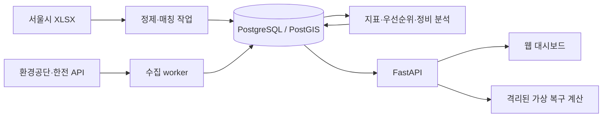

# 서울시 급속충전소 운영 최적화 대시보드

> 실제 충전실적과 현재 운영상태를 결합해 복구 우선순위, 계획정비 후보시간, 복구 전후 설비 용량 변화를 제시하는 웹사이트 개발 명세.

계획서 제목: **실제충전수요 및 운영상태기반 서울시 급속충전 인프라 취약성 분석과 유지보수 운영최적화**  
계획서 작성자: 강성록, 김재우  
README 작성일: 2026-10-16  
문서 상태: 개발 착수용 상세 설계 초안. 구현·배포·API 실관측·원자료 재분석이 완료되었다는 의미가 아니다.

## 1. 문서의 근거와 표기

- **[계획서]**: 첨부 `계획서_강성록, 김재우.hwpx`에 명시된 내용. 원자료 검증 결과에 관한 서술도 계획서의 보고를 인용한 것이며, 이 README 작성 과정에서 XLSX를 재검증한 것은 아니다.
- **[공식 확인]**: 작성일에 공식 데이터 소개 페이지에서 확인한 정보. 인증키를 사용한 API 실응답 검증과 구분한다.
- **[제안]**: 구현을 위해 추가한 설계, 계산식, 기준값, 화면 구성 및 기술 선택. 실증적으로 검증된 연구 결과가 아니다.
- **[확인 필요]**: 원자료·API 응답·운영 담당자의 확인을 거쳐 확정할 항목.

별도 표시가 없는 6~15장의 구현 상세는 **[제안]**이다. 계획서의 수치와 본 문서의 예시·기준값을 혼용하지 않는다.

## 2. 목적과 사용자

**[계획서]** 충전기 설치 대수만으로 실제 서비스 취약성을 판단하기 어렵다. 같은 출력의 충전기가 운영중지되더라도 해당 시설의 이용실적, 전체 출력에서 차지하는 비중, 주변 정상 급속충전망에 따라 영향이 달라진다.

핵심 질문은 다음과 같다.

1. 어떤 충전기의 운영중지가 상대적으로 큰 서비스 영향을 주는가?
2. 제한된 정비 자원으로 무엇부터 복구할 것인가?
3. 예방점검·계획정비는 어느 요일과 연속 1시간·2시간에 수행하는 것이 적절한가?
4. 선택한 충전기를 복구하면 정상 운영 정격출력이 얼마나 회복되는가?

**[제안]** 주요 사용자는 충전시설 운영 담당자, 유지보수 담당자, 분석·연구 담당자다. 이 시스템은 의사결정을 지원하며 실제 충전기 제어나 정비 작업 발주를 자동 수행하지 않는다. 감전·화재 등 안전사고와 긴급 현장조치는 분석 점수보다 우선한다.

### MVP와 제외 범위

| MVP에 포함 | 초기 범위에서 제외 |
|---|---|
| 분석대상 지도·상세, 현재 상태와 관측시각 | 서울시 전체 충전기의 완전한 전수조사라는 주장 |
| 충전량·이용집중도·주변 대체망 분석 | 개별 충전기 실측 충전량이 없는 상태에서의 이용량 단정 |
| 운영중지 충전기 복구 우선순위와 산정 근거 | 실제 대기시간·고장 원인·미래 수요 예측 |
| 과거 이용패턴 기반 정비 후보시간 | 수리비·인력 이동시간을 포함한 작업경로 최적화 |
| 선택 복구 시나리오의 출력 전후 비교 | 실제 복구 완료 처리 또는 원격 제어 |

## 3. 분석 범위와 계획서 보완사항

### 3.1 시간 범위

**[계획서]** 2-1절은 ‘2023~2025년 급속충전량 전체’와 ‘1년 전체’를 함께 서술한다. 반면 3-1절과 데이터 목록은 충전량 자료를 2025년, 시작·종료시각 자료를 2023~2025년으로 구분한다.

**[제안: 개발 기준 정리안]** 아래처럼 분리하고 원자료 파일별 실제 기간을 검사한 뒤 확정한다. 상충하는 서술을 확정 사실로 취급하지 않는다.

| 분석 | 기준 기간 | 해석 |
|---|---|---|
| 실제 급속충전 이용 중요도 | 2025-01-01~2025-12-31 | 연간 및 월별 과거 이용실적 |
| 요일·시간대 이용패턴 | 충전 시작시각 기준 2023-01-01~2025-12-31 | 일부 세션은 2026-01-01 종료 가능 |
| 설비·운영상태 및 대체망 | 2026년 프로젝트 수행 중 수집한 스냅샷 | 해당 관측시점의 상태 |

2025년 이용실적을 2026년 실시간 수요로 표현하지 않는다. 2026년 설비 용량으로 계산한 이용집중도는 ‘과거 실적 / 현재 설비’ 참고 지표이며 과거 실제 가동률이 아니다. 증설·철거·운영자 변경이 확인되면 이력 경고를 표시한다.

모든 화면은 `Asia/Seoul`을 사용한다. 저장 시각은 시간대가 있는 UTC로 통일하되, 원자료의 날짜·시각과 원래 시간대 해석을 함께 보존한다.

### 3.2 공간·설비 범위

**[계획서]** 핵심 대상은 서울시 소유 충전소의 실제 충전량 자료에서 급속 기록이 존재하고 환경공단 API와 동일 시설로 연결되는 충전소다. 급속 기록이 있는 고유 충전소명 **187개**는 후보 규모이며 최종 시설 수나 서울시 전체 급속충전소 수가 아니다.

**[제안]** 포함 조건을 단계별로 적용한다.

1. 서울시 충전량 자료에서 급속 기록 확인.
2. 별칭·주소·좌표·시설 식별 근거를 통해 동일 시설 연결 승인.
3. 급속 충전기 ID, 유효 좌표, 양수 정격출력, 상태 관측정보 확인.
4. 출력·상태·설비 구성의 품질 요건을 충족한 시설만 공식 점수 산출.

일부 데이터가 부족한 시설은 지도에서 ‘분석 보류’로 표시할 수 있지만 순위에는 넣지 않는다. 단계별 통과 수, 탈락 사유, 최종 분석대상 수를 별도로 공개한다.

**[계획서]** 주변 대체망은 대상 충전소 반경 **500m 및 1km** 내 다른 정상 급속충전기다. **[제안]** 대체망은 서울시 소유 시설로 제한하지 않으며, 서울 경계 근처의 대상에 대해서는 인접 지역도 수집한다. 동일 시설의 충전기는 외부 대체망에서 제외한다. 직선거리는 실제 이동거리나 접근시간을 보장하지 않는다고 표시한다.

## 4. 데이터 출처와 확인 상태

| 코드 | 데이터·공식 링크 | 계획서의 용도·확인 상태 | 개발 시 추가 확인 |
|---|---|---|---|
| D1 | [서울시 소유 전기차 충전소의 충전량 / OA-22249](https://data.seoul.go.kr/dataList/OA-22249/F/1/datasetView.do) | 2025년 급속 충전실적. 실제 XLSX 검증 완료로 서술 | 다운로드 파일 버전, 시트·열, 단위, 기간 |
| D2 | [서울시 소유 전기차 충전기 일별·시간별 충전현황 / OA-22258](https://data.seoul.go.kr/dataList/OA-22258/F/1/datasetView.do) | 2023~2025년 이용패턴. 실제 XLSX 검증 완료로 서술 | 세션 의미, 시작·종료 필드, 급속 전용 여부 |
| D3 | [한국환경공단 전기자동차 충전소 정보 / 15076352](https://www.data.go.kr/data/15076352/openapi.do) | 위치·ID·출력·상태. 명세 확인, 실관측 예정 | 최신 가이드 및 인증 실응답, 상태 코드, 설비 중복 |
| D4 | [한국전력공사 전기차 충전소 운영 정보 / 15147132](https://www.data.go.kr/data/15147132/openapi.do) | D3의 보완·교차검증. 최신 필드 확인 예정 | 응답 필드, 식별자 대응, 시각과 상태 의미 |

**[공식 확인]** D3 소개 페이지에서 충전시설·상태정보 제공, REST/XML, 상태조회 주소 `https://apis.data.go.kr/B552584/EvCharger/getChargerStatus`를 확인했다. 인증 실호출은 수행하지 않았다. D1·D2의 연결 페이지 확인은 XLSX 내용 검증을 의미하지 않는다. 공식 명세와 승인 조건은 개발 착수 시 다시 확인한다.

### 4.1 계획서가 보고한 기초통계

| 자료 | 계획서 보고 내용 | 처리 원칙 |
|---|---|---|
| D1 | 고유 충전소명 213개, 급속 기록 포함 이름 187개 | 명칭 수와 실제 시설 수를 구분 |
| D1 | 날짜·충전소명·유형·충전량 결측 없음, 음수 없음 | 동일 검사로 재현 |
| D1 | 0kWh 339건, 완전히 동일한 행 109건 | 원본 보존, 플래그 부여, 임의 삭제 금지 |
| D2 | 고유 충전소명 213개, 주요 변수 결측 없음 | 열 정의와 집계 기준 재확인 |
| D2 | 충전량 음수 1건 | 격리·사유 검토 후 포함 여부 기록 |
| D2 | 충전기 ID와 급속·완속 구분 없음 | 급속 전용시설 확인분 중심으로 정비 분석 |

‘완전히 동일한 행 109건’이 중복 그룹 전체 행인지 첫 행을 제외한 중복 행인지 명시되어 있지 않다. 재검증 시 두 수치를 함께 보고한다. 거래 ID가 없으므로 동일 값이라는 이유만으로 중복 거래라 단정하지 않는다.

### 4.2 수집·정제 원칙

- 원본 파일·응답을 수정하지 않고 수집시각, 출처, SHA-256, 파일명, 시트명, 행 번호, 수집 실행 ID를 기록한다.
- 파생 데이터는 원본 해시, 정제 규칙 버전, 매칭 버전으로 재생성 가능하게 만든다.
- 0kWh는 유효한 0과 수집 누락을 구분한다. 날짜가 없는 경우를 자동으로 0으로 채우지 않는다.
- D1은 동일 행 유지 결과를 기본으로 하고, 의심 중복 제거 민감도 결과를 별도로 제공한다.
- D2의 종료≤시작, 과도하게 긴 세션, 파싱 실패, 음수 충전량을 플래그 처리한다. 시간 분석에 포함할지는 원인 검토 규칙으로 결정한다.
- 원자료 이용허락 조건을 확인한 후 배포 범위를 결정한다. 저장소에는 인증키와 비공개 원본을 넣지 않는다.

## 5. 지표 정의

**[계획서]** 실제 충전량, 충전기당·정격출력당 이용집중도, 총 정격출력, 정상 가용 정격출력 및 운영중지 현황을 제공한다.

**[제안]** 시설 s, 충전기 i, 관측시점 t를 기준으로 다음을 사용한다.

| 지표 | 정의 | 단위·주의 |
|---|---|---|
| 연간 급속충전량 E_s | 2025년 해당 시설 급속 충전량 합 | kWh/년 |
| 월별 충전량 E_s,m | 같은 기준의 월 합 | kWh/월; 누락월 표시 |
| 급속 충전기 수 N_s | 확인된 비삭제 물리 설비 수 | 커넥터 수와 혼용 금지 |
| 총 정격출력 P_s | 유효한 급속 설비 출력 p_i 합 | kW; 공유출력 중복 주의 |
| 충전기당 이용집중도 | E_s / N_s | kWh/기·년; 개별 기기 이용량 아님 |
| 정격출력당 이용집중도 | E_s / P_s | kWh/kW·년; 현재 설비 기준 참고값 |
| 정상 운영 정격출력 H_s(t) | 최신 정상 상태 설비 출력 합 | 이용가능+충전중; 즉시 빈 용량 아님 |
| 즉시 이용가능 정격출력 V_s(t) | 최신 이용가능 상태 설비 출력 합 | 접근·예약 상황까지 보장하지 않음 |
| 운영중지 정격출력 O_s(t) | 최신 운영중지 상태 설비 출력 합 | 물리 고장 확정량이 아님 |
| 상태불확실 출력 U_s(t) | 통신이상·미확인·신선도 불충족 출력 합 | 정상 또는 중지에 편입하지 않음 |

출력 결측이 있으면 알려진 출력의 부분합과 완전성 비율을 표시한다. 완전하지 않은 P_s로 공식 영향도를 계산하지 않는다. 공유형 설비는 물리 장비 또는 전력 공유 그룹 단위로 중복 계산을 막고, 한도를 확인할 수 없으면 명목 합산이라는 한계를 표시하며 정밀 시뮬레이션에서 제외한다.

## 6. API 수집과 동일 시설 매칭

### 6.1 수집 구조

`D1·D2 원본 → 정제 → 시설 매칭 → 이용실적 집계`와 `D3·D4 응답 → 설비 정규화 → 상태 이력`을 분리한 뒤, 동일 스냅샷 ID에 분석 결과를 결합한다.

- 외부 API는 서버에서 호출한다. 브라우저에는 공공데이터 인증키를 전달하지 않는다.
- D3 설비 목록과 상태 갱신을 분리한다. 목록 호출 경로·요청 필드는 최신 가이드와 실응답으로 확정한다.
- 페이지별 결과, 전체 건수, 응답 오류코드, 실패·재시도 이력을 확인한다. 일부 페이지만 받은 실행을 완전한 스냅샷으로 발행하지 않는다.
- 증분 응답에 나타나지 않은 충전기를 삭제·정상·중지로 추정하지 않는다. 명시적 삭제 정보 또는 전체 목록 대조를 사용한다.
- 할당량 내에서 관측주기를 정한다. 증분 조회 범위보다 긴 수집 장애가 발생하면 전체 상태 동기화 가능 여부를 확인하고, 불가능하면 관측 공백을 표시한다.
- 수집 완료시각과 제공기관 상태시각을 각각 보존한다. API 요청 성공만으로 모든 개별 상태가 최신이라고 단정하지 않는다.
- 재시도는 지수 백오프를 적용하고 인증 실패·할당량 초과를 별도로 알린다.

### 6.2 내부 표준 필드

아래는 내부 설계 이름이며 외부 API의 실제 필드명이라고 가정하지 않는다. 어댑터 매핑표는 실응답 후 확정한다.

| 내부 필드 | 의미 |
|---|---|
| provider, source_station_id, source_charger_id | 제공기관 내 설비 식별자 |
| canonical_station_id, canonical_charger_id | 검토 완료된 내부 시설·설비 ID |
| name_raw, address_raw, lat, lon | 명칭·주소 원문 및 좌표 |
| charger_type_raw, connector_types, power_kw | 유형 원문·호환 방식·출력 |
| physical_unit_id, sharing_group_id | 커넥터 및 공유출력 중복 방지 |
| status_raw, normalized_status | 원본 코드와 내부 분류 |
| source_updated_at, observed_at, last_verified_at | 제공기관 갱신·응답 수신·상태 검증 시각 |
| access_restriction, service_hours, deleted | 접근 제한·이용시간·삭제 정보 |
| mapping_version, snapshot_id | 추적 가능한 매핑·관측 버전 |

### 6.3 매칭 절차

1. 명칭의 공백·괄호·표기를 정규화하되 지점·동·주차장 등 시설 식별 정보는 보존한다.
2. 주소·시설 별칭으로 후보를 만들고, 좌표가 있으면 거리로 후보를 좁힌다. D1에 주소가 없다면 보조 자료를 확보하고 명칭만으로 자동 확정하지 않는다.
3. 주소와 공간적 위치, 운영자·시설명, 급속 설비 구성을 함께 검토한다. 예시 거리 100m는 후보 검색용 설정값이며 동일 시설 판정 기준이 아니다.
4. 원본 명칭 1개가 여러 API 충전소 ID에 대응하는 경우 같은 시설인지 확인하고 내부 시설 ID로 묶는다. 여러 원본 이름의 병합도 검토한다.
5. `approved / review_required / rejected / unmatched` 상태와 근거, 검토자, 검토시각을 저장한다.
6. 승인된 매칭만 분석에 사용하며 매칭 변경 시 영향 지표를 재계산한다.

수동 검토 목록에 동명이소, 좌표 이상, 다대다 연결, 충전소 이전·폐지를 우선 표시한다. 공개 대시보드에는 승인 비율과 제외 사유를 제공한다.

### 6.4 한국전력 교차검증

공통 ID 또는 검토된 대응표로 동일 물리 설비임이 확인된 경우에만 비교한다. 예시 비교 허용 시차는 5분으로 설정하되 실제 갱신 특성에 따라 조정한다. 결과는 `일치 / 불일치 / 시간차로 비교 불가 / 매칭 불가`로 기록한다. 불일치를 임의 다수결로 해결하지 않으며 D3 기본 상태와 D4 보조 상태를 함께 보여준다. D4 연결 실패가 전체 분석을 중단시키지 않도록 한다.

## 7. 운영상태 분류와 신선도

원본 숫자 코드와 아래 분류의 대응은 **최신 명세 및 실응답 검증 후 확정**한다. 검증되지 않은 숫자 코드를 하드코딩하지 않는다.

| 내부 상태 | 의미 | 정상 출력 | 복구 우선순위 |
|---|---|---|---|
| AVAILABLE | 이용가능 | 포함 | 제외 |
| CHARGING | 충전중 | 포함 | 제외 |
| STOPPED | 제공기관이 운영중지로 보고 | 제외 | 최신성 충족 시 포함 |
| MAINTENANCE | 별도 점검 상태가 식별 가능한 경우 | 제외 | 계획정비 목록으로 분리 |
| COMM_ERROR | 통신이상 | 제외, 불확실 출력으로 집계 | 현장 상태 확인 목록 |
| UNKNOWN | 미정의 코드·누락 | 제외, 불확실 출력으로 집계 | 확인 목록 |
| DELETED | 삭제·폐지 | 현행 설비 모집단 제외 | 제외 |

신선도는 상태와 독립된 `fresh / stale / unverified` 속성으로 저장한다. 최신성이 불충분하면 마지막 상태를 회색 배지로 보여주고 공식 복구 순위 및 정상 대체망 계산에서 제외한다. 운영중지는 고장 원인 확정이 아니므로 화면에서 ‘물리 고장’으로 바꾸어 표시하지 않는다.

상태시각이 ‘마지막 변화 시각’인지 ‘현재 상태 확인 시각’인지 먼저 확인한다. 변화가 없는 정상 설비를 오래된 변화 시각만으로 stale 처리하지 않는다. 초기 제안 임계값은 검증된 관측주기의 3배이며, 해당 상태를 현재 확인했다는 근거가 있을 때만 `last_verified_at`을 갱신한다. 증분에 없었다는 사실만으로 이 시각을 갱신하지 않는다.

## 8. 고장 영향도 계산식 초안

### 8.1 해석과 입력

**[계획서]** 이용수요, 해당 충전기의 시설 내 출력 비중, 500m·1km 정상 대체망 부족 정도를 종합한다. 구체적 산식·가중치는 제시하지 않았다.

**[제안]** 아래 `impact-v0.1`은 설명 가능한 상대적 우선순위 지수다. 손실 충전량, 고장 확률 또는 대기시간을 예측하지 않는다. 계산 대상 모집단·반경·관측시점·파라미터를 고정해야 점수를 비교할 수 있다.

시설 s와 그 충전기 i에 대해:

```text
E_s       = 2025년 시설 급속 충전량 합(kWh)
P_s       = 시설의 유효한 전체 급속 정격출력(kW)
p_i       = 해당 물리 충전기의 정격출력(kW)
Q95       = 고정된 적격 시설 모집단 E_s의 95백분위수
D_s       = min(1, ln(1 + E_s) / ln(1 + Q95))
S_i       = p_i / P_s
A_s,r,t   = 반경 r 내 외부의 적격 정상 급속 설비 출력 합(kW)
B_s,r,t   = K / (K + A_s,r,t)
I_i,r,t   = 100 × D_s × S_i × B_s,r,t
```

`K=200kW`는 초기 민감도 실험을 위한 제안값이다. K는 대체망이 이만큼 존재할 때 부족도 B가 0.5가 되는 기준 용량이다. 곱셈식은 수요·출력 비중·대체망 부족이 함께 높을 때 높은 점수를 부여한다. 결과 범위는 0~100이며 모집단 변경에 따라 정규화 기준도 달라진다.

### 8.2 주변 대체망 정의

- 반경 500m와 1km를 각각 계산한다. 두 원은 중첩되므로 출력 합을 더하지 않는다.
- 기본 순위는 1km 기준, 500m 결과는 비교값으로 제안한다. 화면에서 기준을 바꾸면 전체 목록을 같은 기준으로 다시 정렬한다.
- 자기 시설은 제외하고 중복 물리 설비를 제거한다. 급속 여부·호환성·접근 조건·신선도를 충족한 AVAILABLE 및 CHARGING 설비를 포함한다.
- 충전중 설비는 구조적 대체 용량에 포함하지만 즉시 사용 가능하다는 의미가 아니다. AVAILABLE만 포함한 별도 참고값을 제공한다.
- 접근이 제한되거나 호환성·이용시간을 확인할 수 없는 설비는 기본 합산에서 제외하고, 포함 시나리오를 별도로 비교한다.
- 대체망 자료가 완전히 수집되었을 때의 A=0만 ‘대체망 없음’이다. 수집 실패·좌표 결측을 A=0으로 변환하지 않는다.
- PostGIS geography의 미터 단위 거리로 경계 포함 여부를 계산한다. 도로망·하천·출입구 장애는 반영하지 못한다.

### 8.3 예외와 순위

E 결측, P≤0, p≤0, p>P, Q95≤0, 승인 매칭 없음, 불완전 설비 구성, 대체망 수집 불완전이면 `score=null`과 사유를 반환한다. 실제 유효 E=0은 점수 0이며 결측과 구분한다. Q95와 모집단 ID는 분석 실행에 저장한다.

순위에는 최신 STOPPED 충전기만 포함한다. 동점은 미반올림 점수→출력 내림차순→안정적인 내부 ID 순으로 정렬한다. 표시 반올림 때문에 동점처럼 보이면 동일 표시 점수임을 알린다. 확실한 중지 시작시각이 없으면 최초 관측시각을 고장 발생시각으로 사용하지 않는다.

### 8.4 가상 계산 예

다음 수치는 실제 서울시 데이터가 아니다.

```text
D_s = 0.8, P_s = 400kW, p_i = 200kW, K = 200kW
S_i = 200 / 400 = 0.5

외부 대체망 0kW:   B=1.0 → I=40.0
외부 대체망 200kW: B=0.5 → I=20.0
외부 대체망 600kW: B=0.25 → I=10.0
```

### 8.5 검증과 한계

K=100/200/400kW, 반경 500m/1km, 중복 의심 행 포함/제외, 대체망 접근조건별로 상위 10개 중첩률과 순위 상관을 비교한다. 급격한 순위 변동은 불안정 경고로 표시한다. 점수는 검증된 경제적 피해액이 아니며 높은 점수가 실제 이용자 불편을 정확히 측정한다는 주장을 하지 않는다.

## 9. 정비시간 추천

### 9.1 적용 대상

**[계획서]** D2에는 충전기 ID와 급속·완속 구분이 없어 급속 전용시설을 확인한 충전소 중심으로 분석한다. 연속 1시간·2시간의 낮은 이용 시간대를 추천한다.

**[제안]** 시설 단위 이용 중첩을 사용한다. 혼합 시설을 급속 전용처럼 분석하지 않으며, 2026년 현재 급속 전용이라는 정보만으로 2023~2025년도 동일했다고 가정하지 않는다. 당시 구성을 확인하지 못하면 추천을 보류하거나 혼합 수요 참고자료로만 표시한다.

### 9.2 알고리즘

1. 유효 세션을 KST의 반개구간 `[시작, 종료)`으로 해석한다.
2. 자정·요일·연도 경계를 넘는 세션을 실제 겹치는 구간에 나눈다. 종료가 2026-01-01인 세션도 분석 종료 경계 안의 중첩만 계산한다.
3. 매일 15분 간격으로 시작하는 60분·120분 후보창을 생성한다. 일요일→월요일처럼 자정을 넘는 창도 허용한다.
4. 특정 날짜 d의 후보창 W에 대해 `C(d,W)=Σ 세션과 W의 중첩 분`을 계산한다. 동시 충전 때문에 창 길이보다 클 수 있다.
5. 같은 요일의 관측 가능한 날짜에 대해 `cost(w,W)=평균 C(d,W)`를 계산한다. 단위는 세션·분이며 kWh나 점유율로 표시하지 않는다.
6. 유효 관측 날짜 수, 비용 분포, 최근 연도 결과를 함께 저장하고 비용이 낮은 상위 3개 후보를 제시한다.
7. 겹치는 추천창이 반복되지 않도록 같은 길이의 후보 사이에 비중첩 조건을 적용한다. 동점은 관측량이 많은 창, 시간순으로 정렬한다.

세션이 없던 날짜가 실제 미이용인지 자료 누락인지 구분 가능한 커버리지 정보를 사용한다. 누락일을 0으로 간주하지 않는다. 커버리지 근거가 없으면 추천 신뢰도를 낮추고 자동 확정을 금지한다.

초기 최소 표본 기준은 해당 요일의 유효 날짜 **20일 이상**으로 제안한다. 미달 시 ‘표본 부족’을 반환한다. 2025년 단독 결과와 2023~2025년 결과를 비교하며 계절·운영시간 변경으로 차이가 크면 경고한다. 장기간 자료가 최근 변화에 둔감할 수 있으므로 최신 연도 필터를 제공한다.

### 9.3 화면 및 운영 제약

추천 결과에는 요일·시작/종료·길이·평균 중첩 세션분·관측일 수·분석기간·급속 전용 확인 상태를 표시한다. 관측 변동 범위를 제공할 경우 계산 방식과 표본 수를 함께 제시한다.

시설 접근 가능시간, 작업자 근무시간, 야간작업 제한, 필수 운영 용량을 입력받아 후보를 거른다. 충전 이용가능시간과 정비 접근 가능시간은 별도 조건이다. 긴급 복구를 저수요 시간까지 지연시키는 기능으로 사용하지 않는다. 차단 예정 기기 수에 따른 정확한 이용 영향은 개별 기기 이력이 없으면 산출하지 않는다.

## 10. 복구 시뮬레이션

**[계획서]** 실제 대기시간이나 미래 이용량 대신 정상 가용 정격출력 증가, 운영중지 출력 감소, 고영향 미복구 충전기 감소를 전후 비교한다.

### 10.1 고정 스냅샷 시나리오

사용자가 최신 STOPPED 설비 집합 R을 선택한다. 관측 스냅샷·설비 구성·E·Q95·공식 버전을 고정한 상태에서 해당 설비만 정상 운영으로 바꾸는 가상 계산을 수행한다. 실제 API 상태나 운영 데이터는 변경하지 않는다.

독립 출력 설비에 대한 기본 식:

```text
회복출력 ΔP = Σ(i∈R) p_i
H_after = H_before + ΔP
O_after = O_before - ΔP
P_after = P_before
```

공유출력 그룹이 있으면 단순 합 대신 그룹 한도를 반영한 전후 차이를 사용한다. 한도를 모르면 정밀 결과를 내지 않고 해당 설비 제외 사유를 표시한다. 복구가 설비 용량의 신설을 의미하지 않으므로 총 정격출력 P는 증가하지 않는다.

### 10.2 출력 항목과 일관성

- 선택 설비 수, 정상 운영 정격출력 전후(kW), 운영중지 정격출력 전후(kW).
- 기준 시점 상위 10개 운영중지 설비 중 남은 미복구 수. 전체가 10개 미만이면 그 수를 기준으로 한다.
- ‘고영향’ 임계값을 사용할 경우 사용자 지정값과 기준 버전을 표시한다. 시나리오마다 임계값을 다시 정해 개선처럼 보이게 하지 않는다.
- 복구된 설비가 다른 시설의 외부 대체망에 들어가면 해당 시설의 잔여 중지 설비 점수도 다시 계산한다. 복구 설비 자신의 시설에서는 외부 대체망으로 더하지 않는다.
- 점수 합의 감소를 회복 kWh로 바꾸지 않는다. 즉시 이용가능 출력 증가도 별도 가정 없이 보장하지 않는다.
- 새 스냅샷이 도착하면 기존 결과에 ‘이전 관측 기준’ 표시를 하고 재계산 선택지를 제공한다.

가상 예: 총 600kW 중 정상 300kW, 운영중지 200kW, 불확실 100kW인 시설에서 독립 설비 100kW를 복구하면 정상 400kW, 운영중지 100kW, 불확실 100kW, 총 600kW다.

이 기능은 선택 시나리오 비교다. 비용·정비시간·인력 제약을 최적화한 최적해라고 표현하지 않는다.

## 11. UI/UX 설계

계획서의 예시 화면은 기능 방향의 참고로 사용한다. 아래 레이아웃과 색상은 새 제안이다.

### 11.1 공통 구조

- 좌측 내비게이션: 현황 / 복구 우선순위 / 정비시간 / 복구 시뮬레이션 / 데이터 품질.
- 상단 고정 정보: **이용실적 2025년**, **운영상태 관측시각**, **분석대상 수**, **갱신 상태**.
- 공통 필터: 자치구, 시설명, 상태, 출력 범위, 영향도 반경, 데이터 품질. 반경과 관측시각은 모든 화면에서 동일하게 유지한다.
- 숫자는 단위를 붙이고 결측은 ‘자료 없음’으로 표시한다. 0과 결측에 같은 스타일을 쓰지 않는다.

### 11.2 화면 명세

| 화면 | 핵심 내용 | 주요 상호작용 |
|---|---|---|
| 현황 | 정상·중지·불확실 출력 카드, 지도와 시설 목록 | 시설 선택 시 우측 상세 패널, 500m/1km 원 |
| 시설 상세 | 연·월 충전량, 설비 구성, 상태·시각, 대체망 | 점수 요소 설명, 출처·품질 펼치기 |
| 복구 우선순위 | 순위·시설·기기·출력·상태·점수·구성요소 | 정렬, 반경 변경, 시뮬레이션에 추가 |
| 정비시간 | 요일×시간 히트맵, 1h/2h 추천 3개 | 연도·길이·작업 가능시간 변경 |
| 복구 시뮬레이션 | 선택 목록과 전후 출력 비교 | 개별 선택·해제, 초기화, 결과 내보내기 |
| 데이터 품질 | 매칭 단계별 수, 결측·신선도·관측 공백 | 보류 사유 조회, 관리자 검토 |

### 11.3 시각·접근성

흰색·옅은 회색 배경에 남색을 기본 강조색으로 제안한다. 정상은 청록, 중지는 주황/빨강, 확인 필요는 회색을 사용하되 아이콘과 텍스트를 반드시 병기한다. 지도 마커는 시설 단위이며 혼합 상태는 ‘중지 2 / 전체 5’처럼 개수를 보여준다.

영향도 설명은 ‘이용 중요도 0.80 × 출력 비중 0.50 × 대체망 부족도 0.50 → 20.0’처럼 재현 가능한 구성으로 제공한다. 상대 순위와 공식 점수의 의미를 툴팁에 명시한다.

키보드로 목록·필터·상세 패널을 조작할 수 있게 하고 지도와 동등한 표를 제공한다. 포커스 표시, 읽기 가능한 명도 대비, 차트 대체 텍스트를 검증한다. 모바일에서는 지도를 목록 아래 탭으로 배치하고 상세 패널을 전체 화면으로 전환한다.

로딩, 빈 결과, API 장애, 오래된 스냅샷, 매칭 보류를 각각 구분한다. 장애 시 마지막 성공 결과와 시각을 보여주며 정상 최신 데이터처럼 보이지 않게 한다.

## 12. 기술스택과 아키텍처

다음은 확정된 기존 시스템이 아닌 제안 조합이다. 라이브러리 버전은 구현 시 호환성을 확인해 잠금 파일로 고정한다.

| 계층 | 제안 | 선택 이유 |
|---|---|---|
| 웹 | React + TypeScript + Vite | 대시보드와 상태·필터 모델 구현 |
| UI·차트 | Tailwind CSS, ECharts | 일관된 구성, 히트맵·월별 차트 |
| 지도 | MapLibre GL JS + 이용조건을 확인한 타일 공급자 | 반경·시설·대체망 레이어 |
| 서버 | Python + FastAPI + Pydantic | 분석 코드와 타입 검증 API 연결 |
| 데이터 처리 | pandas + openpyxl | 서울시 XLSX 검사·집계 |
| 저장소 | PostgreSQL + PostGIS | 시설 관계, 스냅샷, 미터 단위 공간 질의 |
| 스케줄 수집 | 별도 Python worker + 스케줄러 | 웹 요청과 외부 수집 분리 |
| 테스트 | pytest, Vitest, Playwright | 계산·계약·화면 흐름 검증 |
| 실행·배포 | Docker Compose, HTTPS 리버스 프록시 | 개발·시연 환경 재현 |

지도 데이터·타일의 출처와 이용조건은 화면에 표시한다. 실제 타일 공급자와 키 정책은 배포 전에 확정한다. 대규모 큐·캐시는 부하 측정 후 추가하고 MVP에서 불필요한 운영 요소를 줄인다.



### 12.1 데이터 모델

| 테이블 | 핵심 키·내용 |
|---|---|
| source_assets | 파일·API 응답의 출처, 해시, 수집 실행 |
| stations | 내부 시설 ID, 주소·좌표, 소유·범위 구분 |
| station_matches | 원본 시설명, 제공기관 ID, 승인·근거·버전 |
| chargers | 물리 설비 ID, 출력·유형·공유 그룹, 유효기간 |
| charger_source_links | 제공기관별 ID와 내부 설비의 대응 |
| status_observations | 설비 ID, 상태 원문·정규화, 시각·신선도 |
| demand_daily | 시설·날짜·유형·충전량, 원본 행 참조 |
| usage_sessions | 시설, 시작·종료, 품질 플래그, 원본 행 참조 |
| snapshots | 수집 완료·범위·부분 실패·관측 공백 |
| analysis_runs | 모집단, Q95·K·반경·공식·매칭 버전 |
| impact_scores | 실행·설비별 D·S·A·B·점수·보류 사유 |
| maintenance_candidates | 시설·기간·후보창·비용·관측량 |
| simulations | 기준 실행, 선택 설비, 전후 지표·가정 |

설비 유효기간과 관측 이력은 덮어쓰지 않는다. API 원본에 동일 ID가 반복되면 제공기관·시설·설비 키로 멱등 처리하되 커넥터를 물리 장비로 합치는 근거를 별도로 관리한다.

### 12.2 내부 API 계약 초안

아래 경로는 개발할 서비스의 설계이며 현재 동작하는 API가 아니다.

| 메서드·경로 | 용도 |
|---|---|
| GET /api/v1/overview | 분석 범위·정상/중지/불확실 출력 |
| GET /api/v1/stations | 지도·목록; bbox·상태·자치구·페이지 필터 |
| GET /api/v1/stations/{id} | 시설 상세·수요·설비·품질 |
| GET /api/v1/stations/{id}/alternatives | radius_m=500 또는 1000의 대체망 |
| GET /api/v1/priorities | 고정 snapshot_id·analysis_run_id의 순위 |
| GET /api/v1/stations/{id}/maintenance | 기간·duration_minutes별 후보 |
| POST /api/v1/simulations | 기준 실행과 charger_ids를 받아 가상 계산 |
| GET /api/v1/data-quality | 매칭·결측·수집 상태 |
| PATCH /api/v1/admin/matches/{id} | 인증된 관리자의 매칭 검토 |

모든 분석 응답에 `snapshot_id`, `analysis_run_id`, `observed_at`, `demand_period`, `formula_version`, `quality_flags`를 포함한다. 점수 계산 불가 시 null과 사유를 반환한다. 잘못된 반경·길이는 422, 없는 대상은 404, 기준 실행과 선택 설비의 충돌은 409로 처리한다. 부분 실패를 빈 정상 목록으로 반환하지 않는다.

## 13. 제안 폴더 구조와 실행 계약

```text
seoul-fast-charge-ops/
├── README.md
├── .env.example
├── .gitignore
├── compose.yaml
├── apps/
│   └── web/src/
│       ├── pages/
│       ├── components/
│       ├── features/{map,priorities,maintenance,simulation}/
│       ├── api/
│       └── types/
├── services/
│   ├── api/app/{routes,schemas,services}/
│   └── worker/{collectors,normalizers,jobs}/
├── analysis/
│   ├── ingest/
│   ├── matching/
│   ├── demand/
│   ├── impact/
│   ├── maintenance/
│   └── simulation/
├── db/{migrations,seeds}/
├── config/{status_mapping,analysis_defaults,source_schema}/
├── data/{raw,processed}/
├── tests/{unit,integration,e2e,fixtures}/
├── docs/{data_dictionary,matching_rules,methodology,decisions}/
└── reports/{quality,sensitivity,validation}/
```

이 README만으로 위 프로그램이 생성되거나 실행되는 것은 아니다. 아래 환경변수와 실행 절차는 구현 시 제공해야 할 계약이다. 미구현 실행 명령을 작동하는 명령처럼 제시하지 않는다.

```dotenv
# 제안 환경변수: 실제 값은 로컬 .env 또는 배포 비밀 저장소에서 관리
DATABASE_URL=
KECO_SERVICE_KEY=
KEPCO_SERVICE_KEY=
MAP_STYLE_URL=
DISPLAY_TIMEZONE=Asia/Seoul
IMPACT_K_KW=200
DEFAULT_RADIUS_M=1000
```

실행 순서: 환경 설정 → DB 마이그레이션 → 원본 등록·품질 검사 → API 설비 수집 → 매칭 검토 → 상태 스냅샷 생성 → 분석 실행 → 웹/API 기동. 구현 완료 시 실제 검증한 명령과 필수 버전을 이 절에 추가한다.

인증키·개인 환경 파일·원본 대용량 자료는 Git에서 제외한다. 공개 시연은 조회 전용으로 제공하고 매칭 수정·수집 실행은 관리자 권한으로 제한한다. CSV 내보내기에는 출처·기준시각·공식 버전과 스프레드시트 수식 주입 방지 처리를 포함한다.

## 14. 개발 단계와 완료 조건

2인 프로젝트를 가정한 작업 분담 제안이며 작성자의 실제 담당을 지정한 것은 아니다. 데이터 담당과 웹 담당이 API 계약·검증 결과를 공동 검토한다. 기간은 데이터 접근과 매칭 검토에 따라 산정한다.

| 단계 | 산출물 | 완료 조건 |
|---|---|---|
| 0. 범위 확정 | 기간 정정안, 데이터 목록, 설정 결정 기록 | D1/D2 기간·최종 모집단 규칙 합의 |
| 1. 데이터 재현 | 원본 manifest, 품질 보고서 | 계획서 기초통계 재현 또는 차이 설명 |
| 2. API·매칭 | 수집기, 필드·상태 매핑표, 승인 대응표 | 페이지·키·코드 검증, 모든 포함 시설 매칭 승인 |
| 3. 분석 엔진 | 이용지표, 거리·영향도, 정비 후보 | 가상 사례·경계 테스트 통과, 보류 규칙 구현 |
| 4. 웹 MVP | 지도·상세·순위·정비 화면 | 실데이터 또는 명시한 샘플로 핵심 흐름 연결 |
| 5. 시뮬레이션 | 선택 복구와 전후 비교 | 용량 보존·격리·대체망 재계산 검증 |
| 6. 검증·시연 | 민감도 보고서, 배포·실행 설명 | 출처·시각·한계 공개, 주요 검증 기준 충족 |

API 접근이 지연되면 가상 샘플로 화면과 계산을 구현할 수 있다. 이때 모든 화면에 ‘샘플 데이터’를 표시하며 실제 서울시 분석 결과로 제출하지 않는다.

## 15. 검증 기준과 인수 조건

다음은 개발 완료를 판단하기 위한 제안 기준이다. 아직 통과했다는 의미가 아니다.

| 영역 | 검사 | 합격 기준 |
|---|---|---|
| 재현성 | 동일 파일·설정·버전 재실행 | 건수·집계·순위 동일 |
| 원본 품질 | 213/187, 339, 109, 음수 1건 확인 | 일치 또는 파일·정의 차이 보고; 강제 보정 금지 |
| 중복 | 동일 행 포함/제외 집계 | 두 결과 추적 가능, 기본 원본 보존 |
| 매칭 | 포함 시설의 승인 근거·다대다 관계 | 모든 포함 시설 근거 존재, 중복 시설 이중 집계 없음 |
| API 수집 | 다중 페이지·중간 실패·재시도 | 부분 수집 미발행, 재시도 중복 없음 |
| 상태 | 충전중·통신이상·미정의·오래된 상태 | 지정 분류와 보류 규칙 100% 일치 |
| 공간 | 동일 위치, 반경 정확 경계, 서울 경계 | 자기 시설 제외, ≤r 포함, 외곽 누락 없음 |
| 점수 | 가상 예제 40/20/10 | 허용 수치 오차 내 재현 |
| 점수 성질 | 다른 입력 고정, 수요↑/대체망↑ | 수요↑ 시 점수 비감소, 대체망↑ 시 비증가 |
| 결측 | E/P/p/Q95·좌표·대체망 누락 | 0점으로 숨기지 않고 null·사유 표시 |
| 정비 | 자정·주말·연말·동시 충전·누락일 | 손계산 중첩분과 일치, 누락일 0 처리 금지 |
| 추천 표본 | 해당 요일 20일 미만 | 표본 부족 반환 |
| 시뮬레이션 | 빈 선택·중복 선택·부분/전체 복구 | 빈 선택 변화 0, 중복 중복합산 없음, O≥0 |
| 용량 보존 | 독립 설비 복구 | ΔH=-ΔO, 총 P 불변, 불확실 출력 불변 |
| 상태 격리 | 시나리오 실행 전후 원본 조회 | 실제 상태·스냅샷 수정 없음 |
| UI | 지도/표/상세/순위 교차 확인 | 동일 스냅샷·반경에 수치 일치 |
| 접근성 | 키보드·상태색·모바일 | 핵심 작업 가능, 색상 외 의미 전달 |
| 비밀정보 | 번들·응답·로그 검사 | 인증키 노출 없음 |

성능 목표는 제안값으로, 시험 환경과 데이터 규모를 함께 기록한다. 분석 결과를 미리 계산한 상태에서 동시 사용자 10명, 일반 조회 API p95 1초 이내, 기본 화면 사용 가능 3초 이내를 초기 목표로 한다. 외부 API 응답시간은 별도 측정하며 조회 요청에서 외부 API를 직접 기다리지 않도록 한다.

### 15.1 최종 제출 체크리스트

- [ ] D1·D2 실제 파일 및 기간을 확인하고 계획서의 기간 충돌을 결정 기록에 남겼다.
- [ ] 최종 분석대상 수와 187개 후보 명칭 대비 차이를 설명했다.
- [ ] D3/D4 실응답과 상태 코드 매핑을 검증했다.
- [ ] 운영중지와 고장, 정상 운영과 즉시 이용가능을 구분했다.
- [ ] 공식·K·반경·모집단·매칭 버전과 분석시각을 표시했다.
- [ ] 혼합 시설 또는 표본 부족 시설에 무리한 정비 추천을 하지 않는다.
- [ ] 가상 복구 전후 용량 보존 및 원본 상태 격리를 확인했다.
- [ ] 민감도·자료 누락·설비 변경·직선거리의 한계를 공개했다.
- [ ] 실제 실행 명령, 환경, 테스트 결과, 데이터 출처를 문서화했다.

## 16. 구현 전 확정해야 할 결정

| 결정 | 본 문서의 기본안 | 확정 근거 |
|---|---|---|
| 수요·정비 분석기간 | D1 2025 / D2 2023~2025 | 원본 파일 기간 검사 |
| 급속 정의 | 공식 유형과 검증된 설비 속성 사용 | 코드표·실응답; 출력만으로 임의 분류 금지 |
| 최종 모집단 | 승인 매칭·품질 충족 시설 | 매칭 검토 보고서 |
| 공유출력 처리 | 물리 설비·그룹 한도 기준 | 설비 정보 확인 |
| 기본 반경·K | 1km / 200kW | 민감도 결과와 운영 검토 |
| 상태 신선도 | 검증 가능한 주기의 3배 | API 갱신 의미·관측 패턴 |
| 정비 최소 표본 | 요일별 20일 | 데이터 커버리지·변동성 |
| 상태 관측주기 | 승인 할당량 내 결정 | 전체 페이지 수·증분 범위·요청 예산 |
| 지도·배포 환경 | 제안 스택 기반 | 타일 이용조건·시연 환경 |

최종 결과물은 ‘서울의 모든 충전 문제를 해결하는 시스템’이 아니라, 확인 가능한 공개자료 범위에서 **유지보수 판단의 근거와 데이터의 한계를 함께 보여주는 대시보드**를 목표로 한다.

---

## 17. 로컬 구현 산출물 (2026-10-16)

구현 소스와 실행 구성은 이 폴더에 추가했습니다. 위 문서는 설계 근거로 보존합니다. 현재 구현의 실행 방법·범위·미검증 항목은 **[RUNBOOK.md](RUNBOOK.md)**, 실제 원자료 검사 결과는 **[reports/source-quality.md](reports/source-quality.md)**, 테스트 결과는 **[reports/verification.md](reports/verification.md)**에서 확인하세요.

`run-local.cmd`로 패키지 설치 없는 로컬 경량 실행판을 열 수 있습니다. React/FastAPI/PostGIS 구성도 제공하며, 의존성 설치와 Docker 실행은 별도 환경에서 검증해야 합니다. API 인증 실응답과 실제 시설 매칭 승인은 아직 완료되지 않았습니다.

## 18. 대시보드 기능 확장

2026-10-16 추가 요청에 따라 기본 반경 500m, 평균 영향도 산식 `(D + Q + B) / 3`의 `impact-mean-v0.2`로 변경했습니다. 초기 설계의 `impact-v0.1`은 과거 근거로 보존합니다. 최신 탭별 역할·검색·자치구 필터·지도 조작·KPI와 직접 테스트 결과는 [기능 확장 보고서](reports/upgrade-notes.md)를 확인하세요.

## 19. 외부 API 백엔드와 실시간 지도

실시간 화면(`/`)은 내부 API만 호출하고, Python 백엔드가 루트 `.env`에서 `ME_SERVICE_KEY`, `ME_URL`, `KEPCO_SERVICE_KEY`, `KEPCO_URL`을 읽어 수집합니다. FastAPI 경로, SQLite 상태 스냅샷, 상세 오류 분류, Leaflet 지도, 수집 실패 UI를 추가했습니다. 기존 이용실적 분석은 `/analysis`에 보존했습니다.

실제 인증 연동 완료 상태는 아닙니다. 현재 두 URL이 미설정이며 실행 환경의 외부 네트워크 권한 제한이 확인됐습니다. [백엔드 실행 설명](backend/README.md)과 [최신 검증 보고서](reports/backend-verification.md)에서 실제 통과·차단·미검증 항목을 구분해 확인하세요. `ME_INVENTORY_URL` 대신 `ME_URL`을 사용합니다. `scripts/configure_api.py`는 이제 루트 `.env`의 존재 여부만 확인하고 템플릿에서 키를 복사하지 않습니다.

## 20. Windows 로컬 실연동과 UI 복원

19절은 이전 작업 당시 기록입니다. 현재 다섯 환경변수(ME_SERVICE_KEY, ME_URL, ME_STATUS_URL, KEPCO_SERVICE_KEY, KEPCO_URL)가 모두 configured로 확인됩니다. 실제 API 인증 호출은 사용자의 Windows 로컬 Python/FastAPI에서 실행하도록 test_me_api.py와 test_kepco_api.py를 추가했습니다. 한전은 사용자 제공 요청 예시를 사용하고 응답 상태 매핑은 미검증으로 유지합니다. Agent 네트워크 제한으로 로컬 API 실패를 판정하지 않습니다.

기존 디자인과 1차 기능 수정 내용을 `/` 및 React에 복원했습니다. 정상 분석 코드·테스트를 유지하면서 실제 SQLite 관측을 기존 D1/D2 분석 모델에 연결했습니다. [현재 검증 결과와 최대 5단계 실행 명령](reports/local-integration-verification.md), [백엔드 설명](backend/README.md)을 확인하세요.

## 21. 실행환경 미연결 원인 수정

`.env`가 정상인데도 연결되지 않았던 직접 원인은 수집이 꺼진 미리보기 서버와 서버 패키지 미설치였습니다. pip 캐시를 사용해 `.venv`에 FastAPI/uvicorn/requests/dotenv를 설치했고 FastAPI HTTP 테스트와 실행기 검사까지 88개 Python 테스트가 통과했습니다. 기본 실행에서 미리보기로 조용히 대체하는 동작을 제거했습니다. 사용자 Windows에서 `run-local.cmd`를 실행하면 관리 중인 미리보기를 실제 API 수집 서버로 교체합니다. [원인·조치·남은 로컬 확인](reports/api-connection-diagnosis.md)을 확인하세요.

## 22. 최종 기본 실행

사용자 Windows에서 프로젝트로 이동 → `run-local.cmd` 실행 → 브라우저 확인의 3단계로 실제 수집 서버를 시작합니다. 배치 파일은 `.venv`만 사용하고 시스템 Python/호환 서버로 자동 fallback하지 않습니다. 기본 collection_enabled=true이며 미리보기는 명시적 옵션만 허용합니다. [최종 상태 표·검증 범위·3단계 명령](reports/final-local-startup.md)을 확인하세요.
